# TCGA-BRCA DNA甲基化分析与机器学习 / DNA Methylation Analysis and Machine Learning

[中文](#中文说明) | [English](#english-version)

## 中文说明

### 项目概述

本项目基于TCGA-BRCA Illumina HumanMethylation450（HM450）数据，建立了一套从真实公共数据到肿瘤分类模型的完整研究流程，包括甲基化质量控制、差异甲基化位点与区域分析、功能富集、传统机器学习以及轻量级Transformer模型。

**核心贡献：** 将患者配对统计、芯片探针偏倚校正、患者级泄漏控制和可审计的模型比较放入同一流程；同时诚实保留Transformer未超过简单基线的结果，并把它转化为预训练与跨队列泛化的后续研究问题。

> 本仓库提供可复现的分析代码、环境说明和经过筛选的汇总结果，不重新分发TCGA逐样本甲基化矩阵或原始数据。

### 数据集

- **来源：** NCI Genomic Data Commons，TCGA-BRCA
- **数据类型：** SeSAMe Methylation Beta Estimation，Level 3
- **平台：** Illumina HumanMethylation450
- **下载文件：** 890个，全部通过MD5校验
- **QC前独立生物学样本：** 888个
- **QC后样本：** 869个（773个原发肿瘤、96个非肿瘤实体组织）
- **保留特征：** 390,644个常染色体CpG
- **QC后配对队列：** 90对同一患者肿瘤—正常样本

### 分析流程

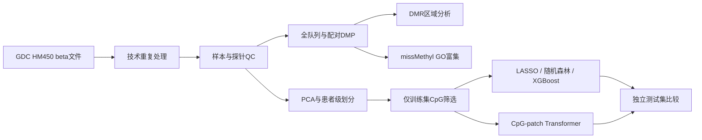

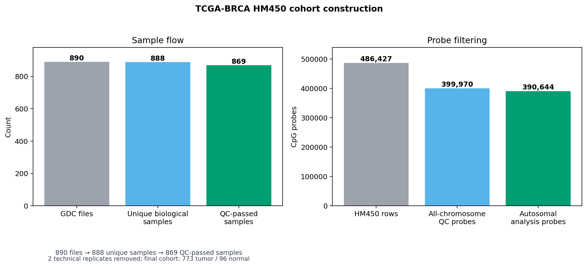

描述性全队列DMP/DMR分析与预测建模严格分开。模型使用的1,000个CpG只通过训练集筛选，验证集和测试集标签没有参与特征选择。

### 质量控制与数据划分

- 排除缺失率超过20%的样本。
- 排除缺失率超过20%的探针、随机位点以及常见CpG/SBE SNP探针。
- 主分析限定为常染色体探针。
- 根据PC1–PC10的分样本类型稳健z分数，没有发现需要排除的PCA离群样本。
- 按患者而不是按单个样本划分数据，保证同一患者的肿瘤和正常样本不会进入不同集合。

| 数据集 | 总数 | 肿瘤 | 正常 |
|---|---:|---:|---:|
| 训练集 | 604 | 538 | 66 |
| 验证集 | 131 | 117 | 14 |
| 测试集 | 134 | 118 | 16 |

### 差异甲基化结果

- 全队列分析：275,082个CpG满足FDR < 0.05，其中28,444个同时满足|Δβ| ≥ 0.20。
- 90对患者配对分析：244,021个CpG满足FDR < 0.05，其中28,827个同时满足|Δβ| ≥ 0.20。
- 两种分析共有25,975个方向一致的大效应CpG。
- 两种分析所有探针Δβ的Pearson相关系数为0.9924。
- DMRcate识别到35,070个全队列DMR和32,541个配对DMR。
- 经过区域重叠、方向、CpG数量和效应量筛选后，得到2,986个高置信全队列区域。

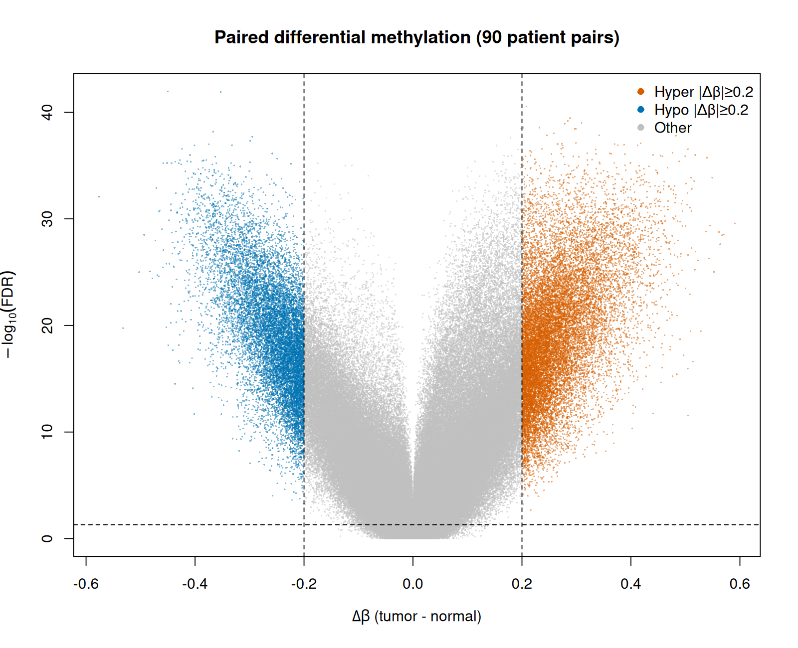

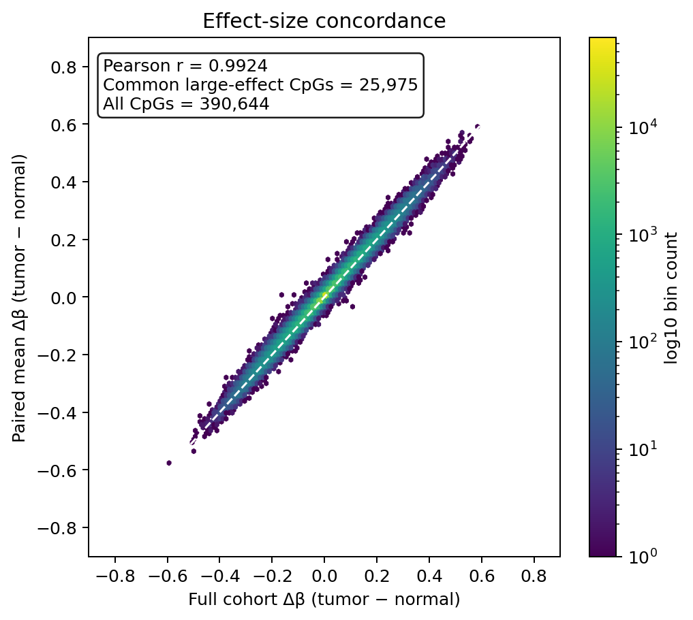

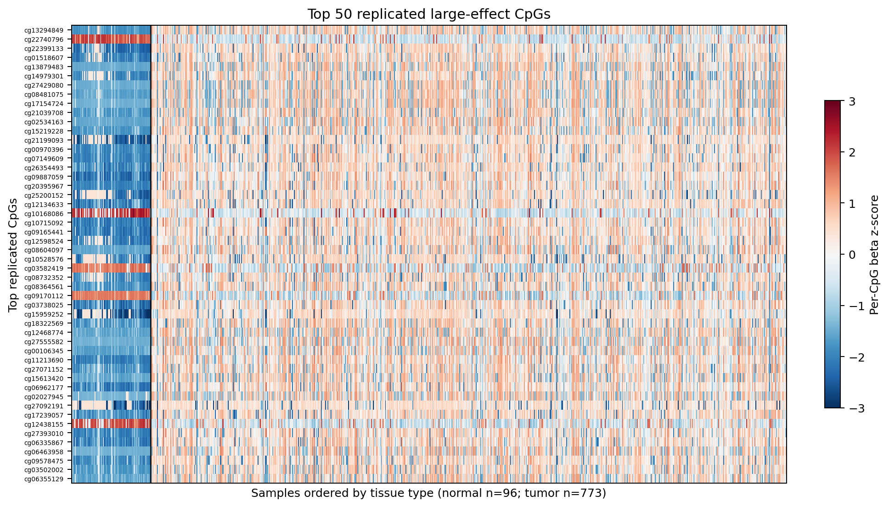

### 功能富集

使用25,975个共同大效应CpG作为显著集合、全部390,644个QC后CpG作为背景，通过`missMethyl`校正HM450探针数偏倚。共有548个GO条目和14条KEGG通路达到FDR < 0.05。KEGG使用官方REST映射的本地缓存完成离线检验；头部结果包括嗅觉转导、神经活性配体—受体相互作用、细胞黏附、Rap1、钙和cAMP信号通路。通路富集表示相关基因附近差异甲基化较集中，不等同于通路功能已被直接激活或抑制。

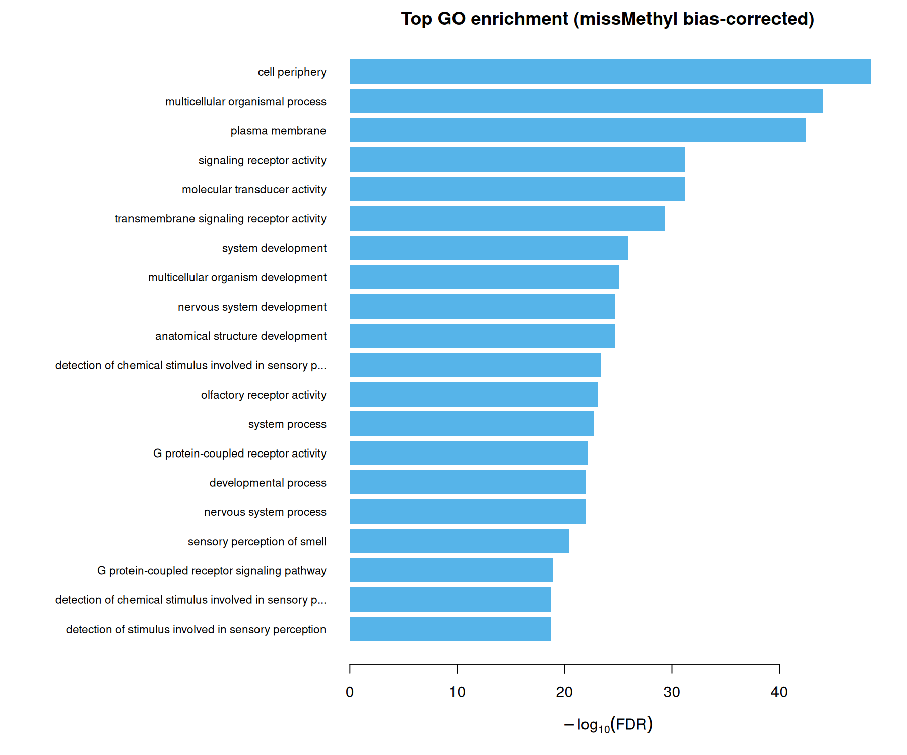

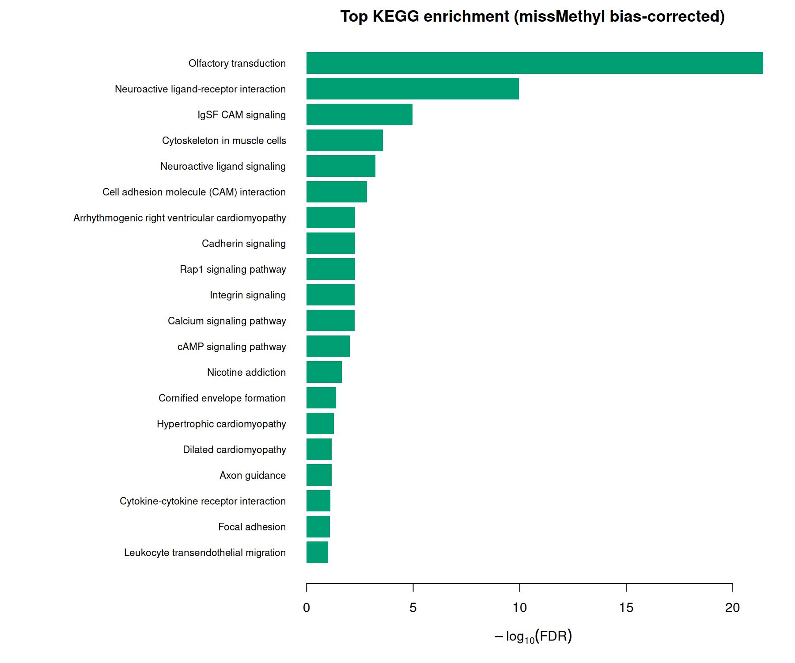

### 防止数据泄漏的模型设计

仅在训练集中对390,644个CpG进行limma检验，按训练集原始P值选择前1,000个CpG，作为所有监督模型的统一输入。验证集与测试集的缺失值均使用训练集中位数填补。

| 模型 | 测试ROC-AUC | 平均精确率 | 准确率 | 敏感度 | 特异度 |
|---|---:|---:|---:|---:|---:|
| LASSO | 0.9926 | 0.9990 | 0.9701 | 0.9746 | 0.9375 |
| 随机森林 | 0.9947 | 0.9993 | 0.9701 | 0.9746 | 0.9375 |
| XGBoost（患者分组CV） | 0.9958 | 0.9994 | 0.9776 | 0.9831 | 0.9375 |
| 染色体安全Transformer（5种子集成） | 0.9873 | 0.9983 | 0.9627 | 0.9576 | 1.0000 |

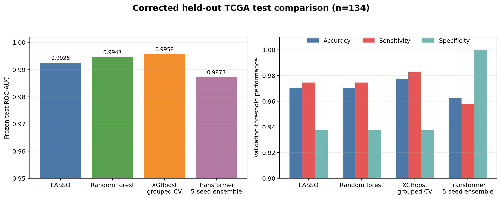

修复后的XGBoost只在训练集内进行5折患者分组交叉验证，以log-loss选择参数和382轮迭代，消除了原实现`best_iteration=0`导致的不可靠结果。轻量级Transformer能够学习有效表征，但仍没有稳定超过简单基线。

测试集134例中仅16例正常：LASSO、RF和修复后的XGBoost均识别15例，Transformer集成识别16例。由于正常样本很少，不能对特异度和小数点后的模型排名作过度解释。

### Transformer设计

- 1,000个训练集筛选CpG，按染色体和hg19坐标排序
- 在每条染色体内部，每10个相邻CpG构成一个patch；共111个patch，其中22个为染色体末端padding patch
- 64维嵌入、4个注意力头、2层编码器
- 78,017个可训练参数
- 类别平衡采样，使用验证集AUC早停
- 5个随机种子，CPU训练最多使用8个线程

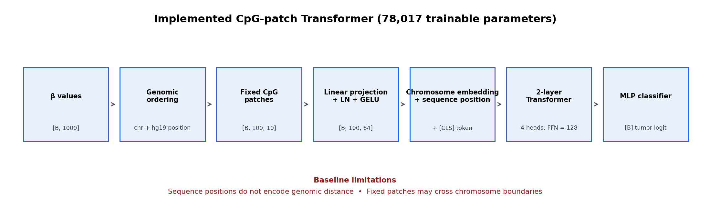

修正版patch不会跨越染色体边界（实测跨染色体patch数为0）。后续预训练实验进一步比较了无位置、顺序位置和“染色体embedding + hg19坐标Fourier特征”三种编码。

### Masked Methylation预训练与少标签实验

在本地RTX 5090 D上，只使用TCGA训练集进行30% patch masking的重建预训练，再以10%、25%、50%和100%训练标签进行三随机种子微调。全部72个微调实验约1分钟完成。基因组位置编码下，预训练相对随机初始化的平均测试AUC增益分别为+0.0009、+0.0032、+0.0019和+0.0028；无位置与顺序位置设置中增益不一致，部分为负。

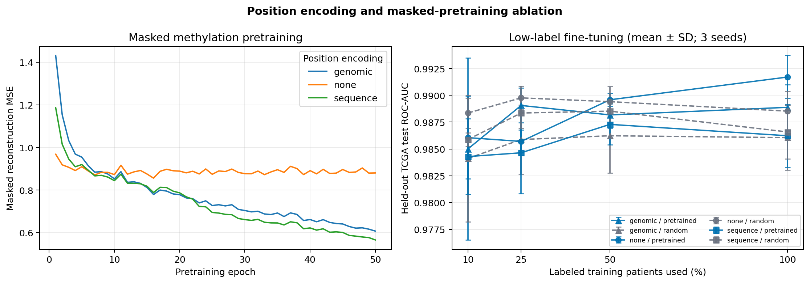

因此，本项目不声称预训练全面优于随机初始化。当前无标签样本仅来自604例训练样本，而且输入仍是监督筛选的1,000个CpG；结果更支持下一步扩大无标签预训练语料和改用不依赖标签的token集合。

### 独立外部队列验证

使用独立HM450队列GSE52865（40个乳腺肿瘤、17个正常乳腺组织）进行冻结验证。1000个TCGA训练期CpG全部命中；没有在外部标签上重新筛特征、重训模型或调整阈值。

| 模型 | 外部ROC-AUC | 准确率 | 敏感度 | 特异度 |
|---|---:|---:|---:|---:|
| LASSO | 1.0000 | 1.0000 | 1.0000 | 1.0000 |
| 随机森林 | 1.0000 | 0.9649 | 1.0000 | 0.8824 |
| XGBoost（患者分组CV） | 1.0000 | 0.9298 | 1.0000 | 0.7647 |
| 基因组位置Transformer（随机初始化） | 0.9779 | 0.8947 | 0.9750 | 0.7059 |
| 基因组位置Transformer（Masked预训练） | 0.9941 | 0.7368 | 0.6250 | 1.0000 |

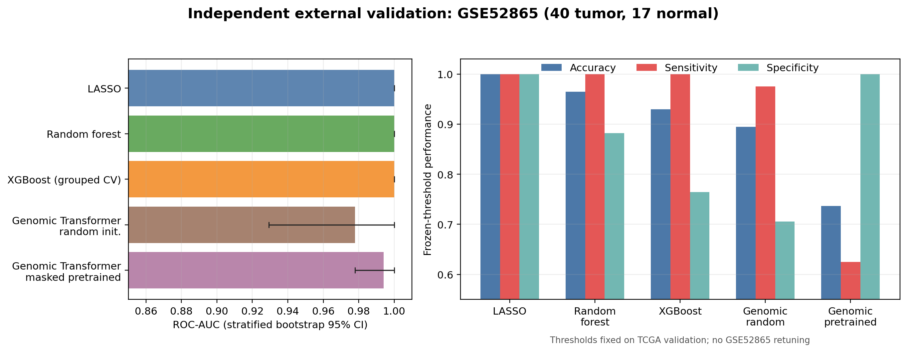

外部AUC说明排序能力可以迁移，但固定TCGA阈值下部分模型的敏感度/特异度明显漂移，尤其是预训练Transformer。这是跨队列概率校准问题，不能通过在外部测试集上重新选阈值来掩盖。

### 局限性

- 测试集只有16个正常样本，特异度估计存在较大不确定性。
- 当前使用一次固定的患者级划分；已补充患者级bootstrap，但仍需要重复划分和嵌套交叉验证。
- 外部验证只有57例，且与TCGA在队列构成、预处理和组织来源上存在差异；需要更多队列验证。
- Masked预训练仅使用604例TCGA训练样本和监督筛选的1,000个CpG，尚不足以证明大规模表征学习优势。
- 本项目使用组织甲基化数据，不能直接解释为血液早筛模型。

### 后续计划

1. 扩大跨队列无标签预训练语料并采用非监督特征集合
2. 完成重复患者级划分和嵌套交叉验证
3. 在更多独立HM450/EPIC队列复核概率校准与泛化
4. 构建共识DMR并整合甲基化—基因表达关系

实现、参数和完整结果见[可靠性、预训练与外部验证报告](docs/EXPERIMENT_UPDATE_2026-10-28.md)。

### 复现与许可证

运行脚本前设置项目根目录：

```bash
export METHYLATION_ROOT=/path/to/TCGA-BRCA-Methylation-ML
```

详细执行顺序、输入文件结构和软件版本见[复现指南](docs/reproducibility.md)和[数据字典](docs/data_dictionary.md)。项目证据与风险见[项目审计](docs/PROJECT_AUDIT.md)，外部迁移方案见[外部验证计划](docs/EXTERNAL_VALIDATION_PLAN.md)，面试准备见[问答集](docs/INTERVIEW_QA.md)。本仓库原创代码采用[MIT许可证](LICENSE)；TCGA/GDC数据及第三方软件仍遵循各自条款，不因本仓库而被重新许可。

---

## English version

An end-to-end research workflow for tumor-versus-adjacent-normal classification using TCGA-BRCA Illumina HumanMethylation450 methylation data. The project combines methylation quality control, differential methylation analysis, genomic region analysis, functional enrichment, conventional machine learning, and a compact Transformer model.

**Core contribution:** one auditable workflow integrating paired-patient statistics, array probe-bias correction, patient-level leakage controls, and model comparison. The Transformer result is reported as-is rather than optimized for presentation.

> This repository contains reproducible analysis code and selected summary outputs. It does **not** redistribute TCGA sample-level methylation matrices or raw data.

## Dataset

- **Source:** NCI Genomic Data Commons, TCGA-BRCA
- **Data type:** SeSAMe Methylation Beta Estimation, Level 3
- **Platform:** Illumina HumanMethylation450
- **Downloaded files:** 890; all passed MD5 verification
- **Biological samples before QC:** 888
- **Samples after QC:** 869 (773 primary tumors, 96 solid-tissue normals)
- **Retained features:** 390,644 autosomal CpGs
- **Paired cohort after QC:** 90 tumor-normal patient pairs

## Workflow

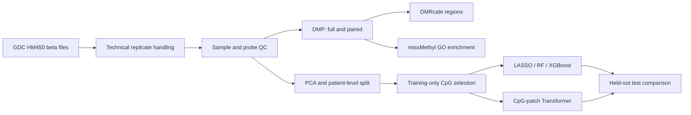

The descriptive full-cohort DMP/DMR analyses and predictive modeling are intentionally separated. Model features were selected using the training split only; validation and test labels were not used for feature selection.

## Quality control and data splitting

- Samples with more than 20% missing beta values were excluded.
- Probes with more than 20% missingness, random loci, and common CpG/SBE SNP probes were excluded.
- The main analysis was restricted to autosomes.
- No PCA outliers were detected using within-sample-type robust z-scores across PCs 1-10.
- Patients, rather than individual samples, were assigned to train/validation/test splits to keep paired tumor-normal samples together.

| Split | Total | Tumor | Normal |
|---|---:|---:|---:|
| Train | 604 | 538 | 66 |
| Validation | 131 | 117 | 14 |
| Test | 134 | 118 | 16 |

## Differential methylation findings

- Full cohort: 275,082 CpGs at FDR < 0.05; 28,444 also had |delta beta| >= 0.20.
- Paired analysis: 244,021 CpGs at FDR < 0.05; 28,827 also had |delta beta| >= 0.20.
- The full and paired analyses shared 25,975 direction-consistent large-effect CpGs.
- Delta-beta values from the two analyses were highly concordant (Pearson r = 0.9924).
- DMRcate identified 35,070 full-cohort and 32,541 paired DMRs.
- After overlap, direction, CpG-count, and effect-size filtering, 2,986 high-confidence full-cohort regions remained.


## Functional enrichment

The common large-effect CpGs were tested with `missMethyl`, using all QC-passed CpGs as the background to correct for HM450 probe-number bias. A total of 548 GO terms and 14 KEGG pathways passed FDR < 0.05. KEGG enrichment used a locally cached official KEGG REST gene-pathway mapping; leading results included olfactory transduction, neuroactive ligand-receptor interaction, cell adhesion, Rap1, calcium, and cAMP signaling. Enrichment indicates concentration of differential methylation near pathway genes and does not by itself establish pathway activation or repression.


## Leakage-aware predictive modeling

Within the training split, all 390,644 CpGs were tested with limma on M-values. The 1,000 CpGs with the smallest training-only raw P values were used as a common input for all supervised models. Missing values in validation and test samples were imputed with medians learned from training samples only.

| Model | Test ROC-AUC | Average precision | Accuracy | Sensitivity | Specificity |
|---|---:|---:|---:|---:|---:|
| LASSO | 0.9926 | 0.9990 | 0.9701 | 0.9746 | 0.9375 |
| Random Forest | 0.9947 | 0.9993 | 0.9701 | 0.9746 | 0.9375 |
| XGBoost (patient-grouped CV) | 0.9958 | 0.9994 | 0.9776 | 0.9831 | 0.9375 |
| Chromosome-safe Transformer (5-seed ensemble) | 0.9873 | 0.9983 | 0.9627 | 0.9576 | 1.0000 |


XGBoost was repaired using five-fold patient-grouped cross-validation entirely within the training split; log-loss selected both hyperparameters and 382 boosting rounds. The chromosome-safe Transformer learned a useful representation but still did not consistently outperform the simpler baselines.

Only 16 normal samples are present in the 134-sample test set, so specificity remains uncertain and decimal-level model rankings should not be over-interpreted.

## Transformer design

- 1,000 training-selected CpGs ordered by chromosome and hg19 position
- 10 neighboring CpGs per chromosome-local patch; 111 patches, including 22 padded chromosome-end patches
- 64-dimensional embeddings, four attention heads, two encoder layers
- 78,017 trainable parameters
- Class-balanced sampling and validation-AUC early stopping
- Five random seeds; CPU training with at most eight threads


The revised patcher has zero cross-chromosome patches. The pretraining ablation compares no positional encoding, learned sequence position, and chromosome embedding plus hg19 coordinate Fourier features.

## Masked methylation pretraining and low-label fine-tuning

Masked-patch reconstruction pretraining used only the TCGA training split and was run locally on an RTX 5090 D. Fine-tuning evaluated 10%, 25%, 50%, and 100% label fractions with three seeds and three positional modes (72 runs). Under genomic positional encoding, pretraining changed mean test AUC by +0.0009, +0.0032, +0.0019, and +0.0028, respectively. Gains were mixed or negative for several no-position and sequence-position settings.


These results do not support a blanket claim that pretraining is superior. The unlabeled corpus is only the 604-sample TCGA training split, and the input remains a supervised-selected 1,000-CpG panel.

## Independent external validation

Frozen models were evaluated on GSE52865 (40 breast tumors and 17 normal breast tissues). All 1,000 TCGA training-selected CpGs were present; no external-label feature selection, model retraining, or threshold tuning was performed.

| Model | External ROC-AUC | Accuracy | Sensitivity | Specificity |
|---|---:|---:|---:|---:|
| LASSO | 1.0000 | 1.0000 | 1.0000 | 1.0000 |
| Random Forest | 1.0000 | 0.9649 | 1.0000 | 0.8824 |
| XGBoost (patient-grouped CV) | 1.0000 | 0.9298 | 1.0000 | 0.7647 |
| Genomic Transformer (random initialization) | 0.9779 | 0.8947 | 0.9750 | 0.7059 |
| Genomic Transformer (masked pretrained) | 0.9941 | 0.7368 | 0.6250 | 1.0000 |


External AUCs indicate transferable ranking, while frozen TCGA thresholds reveal substantial calibration shift for several models—most clearly the pretrained Transformer. Thresholds were not retuned on the external test labels.

## Repository structure

```text
.
├── scripts/
│   ├── 01_data_preparation/
│   ├── 02_quality_control/
│   ├── 03_dmp/
│   ├── 04_dmr/
│   ├── 05_enrichment/
│   ├── 06_model_training/
│   ├── 07_transformer/
│   ├── 08_evaluation/
│   ├── 09_pretraining/
│   └── 10_external_validation/
├── results/
│   ├── figures/
│   ├── model_metrics/
│   ├── summary_tables/
│   └── evaluation/
├── docs/
│   ├── analysis_report.md
│   ├── data_dictionary.md
│   ├── reproducibility.md
│   └── PROJECT_AUDIT.md
└── environment/
```

## Reproducibility

Set the project root before executing scripts:

```bash
export METHYLATION_ROOT=/path/to/TCGA-BRCA-Methylation-ML
```

See [docs/reproducibility.md](docs/reproducibility.md) for the expected project layout, execution order, software environments, and data-access notes.

For a staged entry point, run `bash scripts/run_pipeline.sh {prepare|qc|biology|models|evaluate|all}` after preparing the documented inputs.

## Limitations

- The held-out test set contains only 16 normal samples, so specificity estimates have substantial uncertainty.
- The current results use one fixed patient-level split; patient bootstrap CIs are included, while repeated nested cross-validation remains future work.
- External validation currently contains only 57 samples and differs from TCGA in cohort composition and preprocessing; more cohorts are needed.
- Masked pretraining used only 604 TCGA training samples and a supervised-selected 1,000-CpG panel, limiting claims about large-scale representation learning.
- The analysis uses tissue methylation and is not evidence for a blood-based screening assay.

## Planned extensions

1. Expand unlabeled multi-cohort pretraining with a label-independent feature vocabulary
2. Add repeated patient-level splits and nested cross-validation
3. Validate calibration and generalization in additional HM450/EPIC cohorts
4. Build consensus DMRs and integrate methylation with gene expression

## License and data use

The original code in this repository is released under the [MIT License](LICENSE). TCGA/GDC data and third-party software remain subject to their own terms and are not relicensed by this repository.
