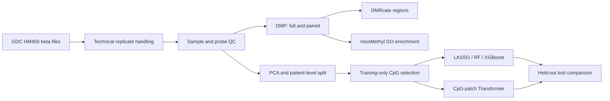
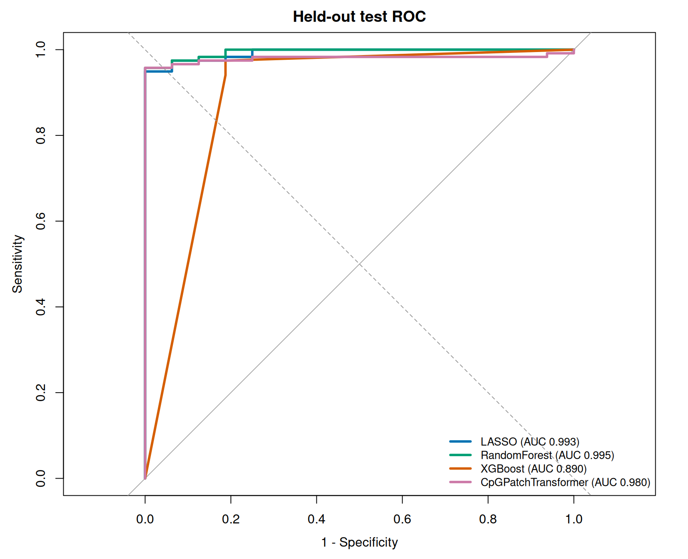

# TCGA-BRCA DNA Methylation Analysis and Machine Learning

An end-to-end research workflow for tumor-versus-adjacent-normal classification using TCGA-BRCA Illumina HumanMethylation450 methylation data. The project combines methylation quality control, differential methylation analysis, genomic region analysis, functional enrichment, conventional machine learning, and a compact Transformer model.

> This repository contains reproducible analysis code and selected summary outputs. It does **not** redistribute TCGA sample-level methylation matrices or raw data.

## Dataset

- **Source:** NCI Genomic Data Commons, TCGA-BRCA
- **Data type:** SeSAMe Methylation Beta Estimation, Level 3
- **Platform:** Illumina HumanMethylation450
- **Downloaded files:** 890; all passed MD5 verification
- **Biological samples before QC:** 888
- **Samples after QC:** 869 (773 primary tumors, 96 solid-tissue normals)
- **Retained features:** 390,644 autosomal CpGs
- **Paired cohort after QC:** 90 tumor-normal patient pairs

## Workflow



The descriptive full-cohort DMP/DMR analyses and predictive modeling are intentionally separated. Model features were selected using the training split only; validation and test labels were not used for feature selection.

## Quality control and data splitting

- Samples with more than 20% missing beta values were excluded.
- Probes with more than 20% missingness, random loci, and common CpG/SBE SNP probes were excluded.
- The main analysis was restricted to autosomes.
- No PCA outliers were detected using within-sample-type robust z-scores across PCs 1-10.
- Patients, rather than individual samples, were assigned to train/validation/test splits to keep paired tumor-normal samples together.

| Split | Total | Tumor | Normal |
|---|---:|---:|---:|
| Train | 604 | 538 | 66 |
| Validation | 131 | 117 | 14 |
| Test | 134 | 118 | 16 |

## Differential methylation findings

- Full cohort: 275,082 CpGs at FDR < 0.05; 28,444 also had |delta beta| >= 0.20.
- Paired analysis: 244,021 CpGs at FDR < 0.05; 28,827 also had |delta beta| >= 0.20.
- The full and paired analyses shared 25,975 direction-consistent large-effect CpGs.
- Delta-beta values from the two analyses were highly concordant (Pearson r = 0.9924).
- DMRcate identified 35,070 full-cohort and 32,541 paired DMRs.
- After overlap, direction, CpG-count, and effect-size filtering, 2,986 high-confidence full-cohort regions remained.


## Functional enrichment

The common large-effect CpGs were tested with `missMethyl::gometh`, using all QC-passed CpGs as the background to correct for HM450 probe-number bias. A total of 548 GO terms passed FDR < 0.05. KEGG retrieval was not completed because the analysis server could not establish SSL connectivity to the KEGG REST endpoint.


## Leakage-aware predictive modeling

Within the training split, all 390,644 CpGs were tested with limma on M-values. The 1,000 CpGs with the smallest training-only raw P values were used as a common input for all supervised models. Missing values in validation and test samples were imputed with medians learned from training samples only.

| Model | Test ROC-AUC | Average precision | Accuracy | Sensitivity | Specificity |
|---|---:|---:|---:|---:|---:|
| LASSO | 0.9926 | 0.9990 | 0.9701 | 0.9746 | 0.9375 |
| Random Forest | 0.9947 | 0.9993 | 0.9701 | 0.9746 | 0.9375 |
| XGBoost | 0.8904 | 0.9985 | 0.9552 | 0.9746 | 0.8125 |
| CpG-patch Transformer | 0.9799 | 0.9975 | 0.9552 | 0.9746 | 0.8125 |



The compact Transformer learned a useful methylation representation but did not outperform the simpler LASSO and Random Forest baselines. This is consistent with the strong, nearly linearly separable tumor-normal signal and the limited number of training samples.

## Transformer design

- 1,000 training-selected CpGs ordered by chromosome and hg19 position
- 10 neighboring CpGs per patch; 100 patches per sample
- 64-dimensional embeddings, four attention heads, two encoder layers
- 78,017 trainable parameters
- Class-balanced sampling and validation-AUC early stopping
- CPU-only training with at most eight threads

## Repository structure

```text
.
├── scripts/
│   ├── 01_data_preparation/
│   ├── 02_quality_control/
│   ├── 03_dmp/
│   ├── 04_dmr/
│   ├── 05_enrichment/
│   ├── 06_model_training/
│   └── 07_transformer/
├── results/
│   ├── figures/
│   ├── model_metrics/
│   └── summary_tables/
├── docs/
│   ├── analysis_report.md
│   ├── data_dictionary.md
│   └── reproducibility.md
└── environment/
```

## Reproducibility

Set the project root before executing scripts:

```bash
export METHYLATION_ROOT=/path/to/TCGA-BRCA-Methylation-ML
```

See [docs/reproducibility.md](docs/reproducibility.md) for the expected project layout, execution order, software environments, and data-access notes.

## Limitations

- The held-out test set contains only 16 normal samples, so specificity estimates have substantial uncertainty.
- The current results use one fixed patient-level split; repeated nested cross-validation and bootstrap confidence intervals are future work.
- This is an internal TCGA evaluation. Independent external-cohort validation is required.
- The Transformer was trained from random initialization; masked methylation pretraining has not yet been evaluated.
- The analysis uses tissue methylation and is not evidence for a blood-based screening assay.

## Planned extensions

1. Bootstrap confidence intervals and repeated patient-level splits
2. External HM450/EPIC cohort validation
3. Masked CpG/region pretraining
4. Low-label fine-tuning experiments at 10%, 25%, 50%, and 100% label availability
5. Consensus DMR construction and methylation-expression integration

## License and data use

The original code in this repository is released under the [MIT License](LICENSE). TCGA/GDC data and third-party software remain subject to their own terms and are not relicensed by this repository.
