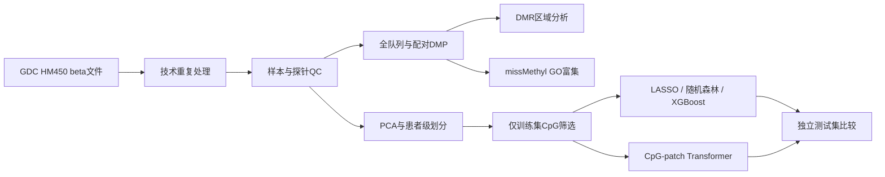
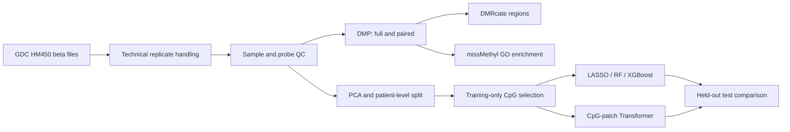

# TCGA-BRCA DNA甲基化分析与机器学习 / DNA Methylation Analysis and Machine Learning

[中文](#中文说明) | [English](#english-version)

## 中文说明

### 项目概述

本项目基于TCGA-BRCA Illumina HumanMethylation450（HM450）数据，建立了一套从真实公共数据到肿瘤分类模型的完整研究流程，包括甲基化质量控制、差异甲基化位点与区域分析、功能富集、传统机器学习以及轻量级Transformer模型。

> 本仓库提供可复现的分析代码、环境说明和经过筛选的汇总结果，不重新分发TCGA逐样本甲基化矩阵或原始数据。

### 数据集

- **来源：** NCI Genomic Data Commons，TCGA-BRCA
- **数据类型：** SeSAMe Methylation Beta Estimation，Level 3
- **平台：** Illumina HumanMethylation450
- **下载文件：** 890个，全部通过MD5校验
- **QC前独立生物学样本：** 888个
- **QC后样本：** 869个（773个原发肿瘤、96个癌旁正常）
- **保留特征：** 390,644个常染色体CpG
- **QC后配对队列：** 90对同一患者肿瘤—正常样本

### 分析流程



描述性全队列DMP/DMR分析与预测建模严格分开。模型使用的1,000个CpG只通过训练集筛选，验证集和测试集标签没有参与特征选择。

### 质量控制与数据划分

- 排除缺失率超过20%的样本。
- 排除缺失率超过20%的探针、随机位点以及常见CpG/SBE SNP探针。
- 主分析限定为常染色体探针。
- 根据PC1–PC10的分样本类型稳健z分数，没有发现需要排除的PCA离群样本。
- 按患者而不是按单个样本划分数据，保证同一患者的肿瘤和正常样本不会进入不同集合。

| 数据集 | 总数 | 肿瘤 | 正常 |
|---|---:|---:|---:|
| 训练集 | 604 | 538 | 66 |
| 验证集 | 131 | 117 | 14 |
| 测试集 | 134 | 118 | 16 |

### 差异甲基化结果

- 全队列分析：275,082个CpG满足FDR < 0.05，其中28,444个同时满足|Δβ| ≥ 0.20。
- 90对患者配对分析：244,021个CpG满足FDR < 0.05，其中28,827个同时满足|Δβ| ≥ 0.20。
- 两种分析共有25,975个方向一致的大效应CpG。
- 两种分析所有探针Δβ的Pearson相关系数为0.9924。
- DMRcate识别到35,070个全队列DMR和32,541个配对DMR。
- 经过区域重叠、方向、CpG数量和效应量筛选后，得到2,986个高置信全队列区域。


### 功能富集

使用25,975个共同大效应CpG作为显著集合、全部390,644个QC后CpG作为背景，通过`missMethyl::gometh`校正HM450探针数偏倚。共有548个GO条目达到FDR < 0.05。由于原分析服务器无法与KEGG REST端点建立SSL连接，本次没有报告KEGG结果。


### 防止数据泄漏的模型设计

仅在训练集中对390,644个CpG进行limma检验，按训练集原始P值选择前1,000个CpG，作为所有监督模型的统一输入。验证集与测试集的缺失值均使用训练集中位数填补。

| 模型 | 测试ROC-AUC | 平均精确率 | 准确率 | 敏感度 | 特异度 |
|---|---:|---:|---:|---:|---:|
| LASSO | 0.9926 | 0.9990 | 0.9701 | 0.9746 | 0.9375 |
| 随机森林 | 0.9947 | 0.9993 | 0.9701 | 0.9746 | 0.9375 |
| XGBoost | 0.8904 | 0.9985 | 0.9552 | 0.9746 | 0.8125 |
| CpG-patch Transformer | 0.9799 | 0.9975 | 0.9552 | 0.9746 | 0.8125 |


轻量级Transformer能够学习有效的甲基化表征，但没有超过LASSO和随机森林。这与肿瘤—正常信号很强、任务接近线性可分以及训练样本有限相符。

### Transformer设计

- 1,000个训练集筛选CpG，按染色体和hg19坐标排序
- 每10个相邻CpG构成一个patch，每个样本100个patch
- 64维嵌入、4个注意力头、2层编码器
- 78,017个可训练参数
- 类别平衡采样，使用验证集AUC早停
- CPU训练，最多使用8个线程

### 局限性

- 测试集只有16个正常样本，特异度估计存在较大不确定性。
- 当前使用一次固定的患者级划分；后续需要重复划分、嵌套交叉验证和bootstrap置信区间。
- 当前属于TCGA内部验证，尚需独立外部队列验证。
- Transformer从随机参数开始训练，尚未进行Masked CpG/区域预训练。
- 本项目使用组织甲基化数据，不能直接解释为血液早筛模型。

### 后续计划

1. 补充bootstrap置信区间和重复患者级划分
2. 在独立HM450/EPIC队列进行外部验证
3. 开展Masked CpG或连续区域预训练
4. 比较10%、25%、50%和100%标签条件下的微调效果
5. 构建共识DMR并整合甲基化—基因表达关系

### 复现与许可证

运行脚本前设置项目根目录：

```bash
export METHYLATION_ROOT=/path/to/TCGA-BRCA-Methylation-ML
```

详细执行顺序、输入文件结构和软件版本见[复现指南](docs/reproducibility.md)和[数据字典](docs/data_dictionary.md)。本仓库原创代码采用[MIT许可证](LICENSE)；TCGA/GDC数据及第三方软件仍遵循各自条款，不因本仓库而被重新许可。

---

## English version

An end-to-end research workflow for tumor-versus-adjacent-normal classification using TCGA-BRCA Illumina HumanMethylation450 methylation data. The project combines methylation quality control, differential methylation analysis, genomic region analysis, functional enrichment, conventional machine learning, and a compact Transformer model.

> This repository contains reproducible analysis code and selected summary outputs. It does **not** redistribute TCGA sample-level methylation matrices or raw data.

## Dataset

- **Source:** NCI Genomic Data Commons, TCGA-BRCA
- **Data type:** SeSAMe Methylation Beta Estimation, Level 3
- **Platform:** Illumina HumanMethylation450
- **Downloaded files:** 890; all passed MD5 verification
- **Biological samples before QC:** 888
- **Samples after QC:** 869 (773 primary tumors, 96 solid-tissue normals)
- **Retained features:** 390,644 autosomal CpGs
- **Paired cohort after QC:** 90 tumor-normal patient pairs

## Workflow



The descriptive full-cohort DMP/DMR analyses and predictive modeling are intentionally separated. Model features were selected using the training split only; validation and test labels were not used for feature selection.

## Quality control and data splitting

- Samples with more than 20% missing beta values were excluded.
- Probes with more than 20% missingness, random loci, and common CpG/SBE SNP probes were excluded.
- The main analysis was restricted to autosomes.
- No PCA outliers were detected using within-sample-type robust z-scores across PCs 1-10.
- Patients, rather than individual samples, were assigned to train/validation/test splits to keep paired tumor-normal samples together.

| Split | Total | Tumor | Normal |
|---|---:|---:|---:|
| Train | 604 | 538 | 66 |
| Validation | 131 | 117 | 14 |
| Test | 134 | 118 | 16 |

## Differential methylation findings

- Full cohort: 275,082 CpGs at FDR < 0.05; 28,444 also had |delta beta| >= 0.20.
- Paired analysis: 244,021 CpGs at FDR < 0.05; 28,827 also had |delta beta| >= 0.20.
- The full and paired analyses shared 25,975 direction-consistent large-effect CpGs.
- Delta-beta values from the two analyses were highly concordant (Pearson r = 0.9924).
- DMRcate identified 35,070 full-cohort and 32,541 paired DMRs.
- After overlap, direction, CpG-count, and effect-size filtering, 2,986 high-confidence full-cohort regions remained.


## Functional enrichment

The common large-effect CpGs were tested with `missMethyl::gometh`, using all QC-passed CpGs as the background to correct for HM450 probe-number bias. A total of 548 GO terms passed FDR < 0.05. KEGG retrieval was not completed because the analysis server could not establish SSL connectivity to the KEGG REST endpoint.


## Leakage-aware predictive modeling

Within the training split, all 390,644 CpGs were tested with limma on M-values. The 1,000 CpGs with the smallest training-only raw P values were used as a common input for all supervised models. Missing values in validation and test samples were imputed with medians learned from training samples only.

| Model | Test ROC-AUC | Average precision | Accuracy | Sensitivity | Specificity |
|---|---:|---:|---:|---:|---:|
| LASSO | 0.9926 | 0.9990 | 0.9701 | 0.9746 | 0.9375 |
| Random Forest | 0.9947 | 0.9993 | 0.9701 | 0.9746 | 0.9375 |
| XGBoost | 0.8904 | 0.9985 | 0.9552 | 0.9746 | 0.8125 |
| CpG-patch Transformer | 0.9799 | 0.9975 | 0.9552 | 0.9746 | 0.8125 |


The compact Transformer learned a useful methylation representation but did not outperform the simpler LASSO and Random Forest baselines. This is consistent with the strong, nearly linearly separable tumor-normal signal and the limited number of training samples.

## Transformer design

- 1,000 training-selected CpGs ordered by chromosome and hg19 position
- 10 neighboring CpGs per patch; 100 patches per sample
- 64-dimensional embeddings, four attention heads, two encoder layers
- 78,017 trainable parameters
- Class-balanced sampling and validation-AUC early stopping
- CPU-only training with at most eight threads

## Repository structure

```text
.
├── scripts/
│   ├── 01_data_preparation/
│   ├── 02_quality_control/
│   ├── 03_dmp/
│   ├── 04_dmr/
│   ├── 05_enrichment/
│   ├── 06_model_training/
│   └── 07_transformer/
├── results/
│   ├── figures/
│   ├── model_metrics/
│   └── summary_tables/
├── docs/
│   ├── analysis_report.md
│   ├── data_dictionary.md
│   └── reproducibility.md
└── environment/
```

## Reproducibility

Set the project root before executing scripts:

```bash
export METHYLATION_ROOT=/path/to/TCGA-BRCA-Methylation-ML
```

See [docs/reproducibility.md](docs/reproducibility.md) for the expected project layout, execution order, software environments, and data-access notes.

## Limitations

- The held-out test set contains only 16 normal samples, so specificity estimates have substantial uncertainty.
- The current results use one fixed patient-level split; repeated nested cross-validation and bootstrap confidence intervals are future work.
- This is an internal TCGA evaluation. Independent external-cohort validation is required.
- The Transformer was trained from random initialization; masked methylation pretraining has not yet been evaluated.
- The analysis uses tissue methylation and is not evidence for a blood-based screening assay.

## Planned extensions

1. Bootstrap confidence intervals and repeated patient-level splits
2. External HM450/EPIC cohort validation
3. Masked CpG/region pretraining
4. Low-label fine-tuning experiments at 10%, 25%, 50%, and 100% label availability
5. Consensus DMR construction and methylation-expression integration

## License and data use

The original code in this repository is released under the [MIT License](LICENSE). TCGA/GDC data and third-party software remain subject to their own terms and are not relicensed by this repository.
